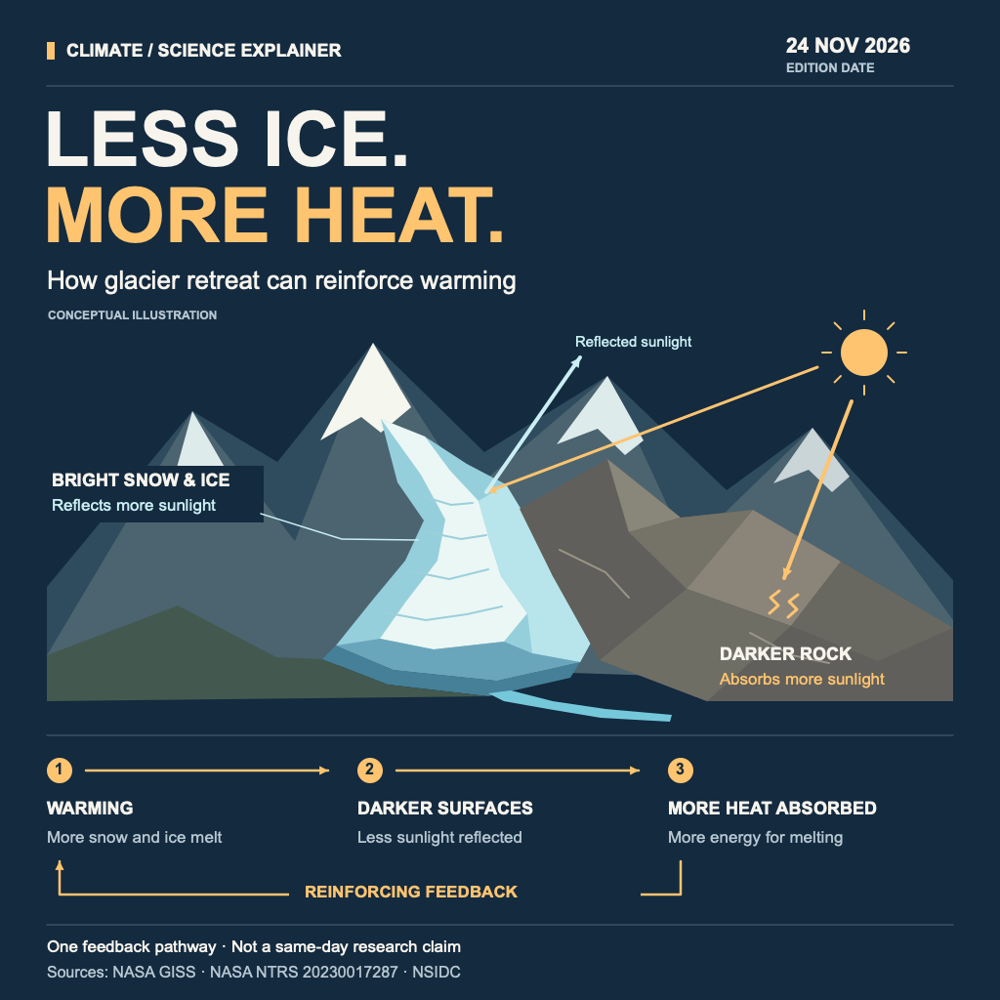

# 冰愈少，吸熱愈多

為 make.fun `news-image-20261124` 主題從零製作的原創冰川反照率回饋科學背景圖。只在本機製作；未付費、上傳、送件、簽名或執行 `record`。



圖中是陸地山谷冰川與裸岩的概念插畫：亮冰雪反射較多陽光；較暗表面吸收較多能量，能促進進一步融化。這是其中一條放大變化的回饋路徑，不代表所有區域效應都由反照率造成。箭頭為定性示意，未宣稱反射百分比、氣溫或融化速率。

**日期與新聞限制：** 反照率回饋機制已有可靠來源；本次未能核實 2026-11-24 當日特定冰川新發現，因此該項為 **UNVERIFIABLE**。圖上 `24 NOV 2026` 明示為 `EDITION DATE`，並標示 `SCIENCE EXPLAINER` 與非同日研究聲明。單一科學背景圖未涵蓋當日全球新聞；本機技術驗收也不是官方新聞評審結果或送件資格保證。

## 本機執行

需要 Node 22；入口僅使用標準庫，不需安裝套件，不連網，不在執行時繪圖。

```sh
MAKEFUN_OUTPUT_DIR=out node main.ts
```

結果寫到 `out/entry.png`。未設定 `MAKEFUN_OUTPUT_DIR` 時，寫到 `/output/entry.png`。來源圖從入口程式自己的位置讀取，因此可以在其他工作目錄執行。來源資料夾可唯讀，只需輸出資料夾可寫。圖檔與程式須放在同一資料夾。

## 從零重建圖像

`build.m` 是可編輯的完整原創幾何繪圖源；以 macOS 內建 AppKit、CoreGraphics 與已安裝的 clang 建置，使用本機 Arial / Arial Bold 字型，沒有外部圖片、字型下載或遠端生成服務。選擇原生程式繪圖，故無額外 SVG；修改幾何、色彩及文案後執行：

```sh
sh build.sh
```

此步驟需要 macOS 與已安裝的 Command Line Tools。它在暫存目錄編譯，生成本資料夾的 `entry.png`，再清理暫存編譯檔。競賽入口 `main.ts` 不需要 macOS、clang 或字型，跨平台只複製隨附的 PNG。不同系統／字型或 AppKit 版本重新繪製可能產生不同像素；正式執行的確定性來自固定隨附圖片。

## 檔案與證據

- `entry.png`：1024 × 1024 成品圖。
- `main.ts`：Node 22 標準庫入口。
- `build.m`、`build.sh`：可重建本機繪圖源。
- `research.md`、`dispatch.md`：查證與建置規格。
- `build-notes.md`：Builder 自檢；獨立驗收另見 `verification.md`（由 Verifier 建立）。

本機交付 zip 是供檢視／執行的包，並非已簽名競賽 source bundle；對話紀錄包另存，不混入分發 zip。官方 kit、憑證、個人設定與原始 session 不屬於圖片交付內容。

## 科學來源

- [NASA GISS：Albedo feedbacks](https://www.giss.nasa.gov/pubs/abs/la02300a.html)
- [NASA NTRS：Greenland melt-albedo feedbacks，紀錄 20230017287](https://ntrs.nasa.gov/citations/20230017287)
- [NSIDC：Science of Glaciers](https://nsidc.org/learn/parts-cryosphere/glaciers/science-glaciers)

上述為機制背景，並非 2026-11-24 當日新研究。完整日期交叉檢查及未採用來源見 `research.md`。官方任務見 [make.fun brief](https://make.fun/bounty/news-image-20261124)；其本機 kit 已由主代理先行核對。

## 授權

原創程式與插畫以 MIT 授權，見 `LICENSE`。沒有重製官方 starter 圖、其他參賽者作品、外部照片或現成插畫。
